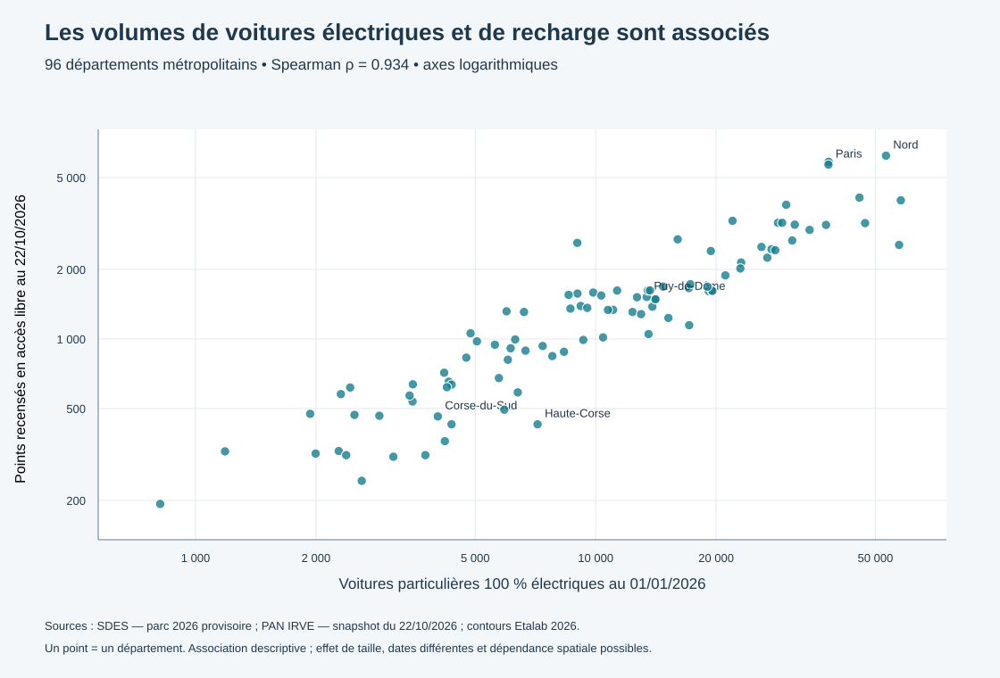

# CM2 — Croiser les voitures électriques et l’offre de recharge

Projet Recharge France, distinct du projet des bars. Préparé le 22 octobre 2026 à partir du snapshot IRVE conservé au CM1. Le changement de marché reste à faire valider par l’enseignant si ce n’est pas déjà fait.

**[Ouvrir le tableau de bord et la carte](index.html)** · [Graphique autonome](graphique_offre_demande.svg) · [Table de jointure](jointure_departements.csv) · [Accueil](../README.md).

## Ce que demande la séance

[Consignes CM2](https://mae.iae-mod.fr/seances/seance-cm-2.html) : documenter chaque source (primaire/secondaire, producteur, rythme, unité, clé), effectuer une première jointure, produire un graphique avec une lecture chiffrée et tester une hypothèse en expliquant le choix du test. Le groupe doit comprendre et valider le test proposé, puis présenter son premier résultat à l’enseignant.

## 1. Question et périmètre

**Les départements où le parc de voitures particulières 100 % électriques est plus important recensent-ils davantage de points de recharge déclarés en accès libre ?**

L’analyse principale porte sur **96 départements métropolitains**. La table conserve les **109 codes territoriaux des contours** : 101 départements et 8 autres territoires. Le SDES renseigne le parc pour 101 codes ; les 8 autres n’ont pas de dénominateur. Les ratios et le test ne sont pas publiés pour l’outre-mer, dont la couverture IRVE s’est révélée très inégale au CM1. Il ne faut pas présenter ce test comme couvrant toute la France.

Unité statistique finale : un département. Offre : nombre de **points de recharge**, pas nombre de stations ou de prises, en **accès libre déclaré**. Demande potentielle : nombre de **voitures particulières électriques** au lieu d’immatriculation, particuliers et professionnels réunis. Les hybrides rechargeables, l’hydrogène, les utilitaires et les véhicules de passage ne sont pas inclus dans le dénominateur principal.

## 2. Audit des sources

Toutes sont **secondaires pour notre groupe**, qui n’a produit aucune enquête originale.

| Source | Producteur et rythme | Unité et clé | Période / précaution |
|---|---|---|---|
| [IRVE statique du PAN](https://www.data.gouv.fr/datasets/beta-bases-nationales-des-points-de-recharge-pour-vehicules-electriques-en-france-irve) | transport.data.gouv.fr, déclarations d’opérateurs consolidées ; rythme nocturne | point de recharge ; id_pdc_itinerance, regroupement possible par station | Snapshot du 22/10/2026 conservé au CM1 ; date_maj propre à chaque point. Données statiques, disponibilité inconnue. |
| [Parc routier SDES](https://www.data.gouv.fr/datasets/parc-de-vehicules-routiers) | SDES / RSVERO, issu des immatriculations et contrôles techniques ; annuel et révisable | cellule commune × carburant × Crit’Air × statut × groupe × catégorie ; année en colonne | PARC_2026 = parc au 01/01/2026, **provisoire**. Adresse d’immatriculation, pas lieu d’usage. |
| Contours Etalab 2026 | Etalab ; millésime géographique | polygone territorial ; code département/territoire | Simplification 1 km ; utilisée pour rattacher des coordonnées à un département, avec imprécision près des limites. |

Le SDES a été téléchargé le **2026-10-22T14:35:19.959354+00:00** : **231 903 737 octets**, SHA-256 **a3fa8333ee7c4feafa2025bf0497f4b39e75e1bbdf59431bf69e3a2c3accb1a6**. Voir [source_parc.json](source_parc.json) et [les sources CM1](../data/sources.json). La page de présentation SDES était en maintenance ; le fichier officiel DiDo était accessible. Le téléchargement n’est pas la date d’observation.

Le SDES précise que les effectifs sont estimés, révisables et peuvent présenter des écarts d’arrondi avec les publications nationales. Des codes commune fictifs « département + 000 » existent lorsque le département est connu : ils peuvent être agrégés au département, mais pas traités comme de vraies communes. Les véhicules non rattachables à un département restent hors jointure, jamais imputés.

**Décalage temporel :** parc du 1er janvier contre offre du 22 octobre 2026. L’analyse est une comparaison exploratoire de deux photographies différentes. On ne prétend pas mesurer l’équilibre offre/demande à une date unique.

## 3. Préparation et jointure

Les sources sont agrégées **séparément** avant la jointure par **code département texte** (01, 2A, 2B, 971…). Aucun code postal n’est utilisé et aucune population ou parc automobile n’est répété sur chaque borne.

### Offre IRVE

Base de départ : **177 464 points** conservés au CM1. Les 50 259 points sans code commune imposent un contrôle supplémentaire.

- Code département déclaré et polygone concordants : **123 146 points**.
- Département obtenu par point dans polygone en l’absence de code valable : **49 394 points**. On dérive seulement le département, **aucun code commune n’est inventé**.
- Code département déclaré conservé faute de coordonnées : **4 points**.
- Exclusions : **2 732 conflits** code/polygone, **1 323 points avec code mais hors polygones**, **865 sans rattachement exploitable**.

Résultat : **172 544 points rattachés**, **4 920 écartés de cette analyse**. Ils restent dans le snapshot CM1. Les polygones simplifiés peuvent écarter des localisations côtières ou proches d’une frontière : ce choix prudent ne certifie pas les coordonnées. Les noms de station ne sont pas utilisés pour deviner un territoire.

### Parc SDES

**2 128 015 lignes lues**, dont **786 703 cellules de voitures particulières**. Filtre GROUPE = VP et CATEGORIE = VP ; une seule année, PARC_2026. Somme des modalités détaillées, sans sous-total. Le carburant **Electrique** fournit le dénominateur ; les autres motorisations ne sont pas assimilées aux voitures électriques. L’unicité de la clé détaillée et l’absence de valeurs manquantes ou négatives ont été contrôlées.

Le fichier totalise **1 412 828 VP électriques** ; **15** ne sont pas rattachables à un département, d’où **1 412 813** dans la jointure territoriale. Les codes fictifs dont le département est connu sont conservés au niveau départemental.

### Contrôles de jointure

1. Unicité des identifiants points et des clés détaillées SDES avant agrégation.
2. Une ligne par code dans chaque table agrégée ; 109 lignes après jointure, sans multiplication.
3. Conservation IRVE : 177 464 = 172 544 rattachés + 4 920 exclus.
4. Conservation du parc électrique : 1 412 828 = 1 412 813 rattachés + 15 exclus.
5. Valeurs absentes conservées comme absentes : les 8 territoires sans parc n’obtiennent pas un zéro fictif. Les zéros recensés d’offre restent des observations du fichier, pas des preuves d’absence d’équipement.

[Contrôles détaillés](controles_jointure.json) · [Parc départemental extrait du SDES](parc_departements_2026.csv) · [Jointure finale](jointure_departements.csv).

## 4. Information nouvelle et premier graphique

Le croisement produit **le nombre de points en accès libre recensés pour 100 voitures particulières électriques** : PDC libres / VP électriques × 100. Ce ratio n’existait dans aucune des deux sources seules.

Sur les **96 départements**, on compte **1 389 300 VP électriques** et **150 583 PDC libres recensés** dans notre périmètre géographique validé. Le ratio agrégé est **10,84 PDC pour 100 VP électriques**. La médiane des ratios départementaux est **11,84** ; la moitié se situe entre **9,26 et 15,44**. Moyenne agrégée et médiane des départements mesurent des choses différentes.

**Phrase de lecture :** parmi 96 départements métropolitains, les rangs du nombre de VP électriques et du nombre de PDC libres recensés sont fortement associés (**Spearman ρ = 0,934**). Les territoires avec davantage de voitures électriques tendent à recenser davantage de points. La taille des territoires peut contribuer à ce lien ; le graphique ne démontre pas que l’offre est adaptée aux besoins. Les axes sont logarithmiques, pour rendre visibles les petits et les grands départements.

**Exemple Puy-de-Dôme :** 1 520 PDC libres recensés / 13 412 VP électriques × 100 = **11,33**. Ce résultat n’est ni un objectif d’équipement ni une estimation de fréquentation.

La carte colore les ratios, sans catégories « bon/mauvais » ni classement d’opportunités. Un ratio élevé peut traduire du passage touristique, une offre plus développée, un parc résident plus faible ou des différences de couverture. Il faut le vérifier avant toute recommandation.

## 5. Hypothèse et test proposé au groupe

- **H0 :** corrélation de rang nulle entre le volume de VP électriques et celui de PDC en accès libre recensés.
- **H1 :** corrélation de rang différente de zéro, test bilatéral.
- Seuil de travail : **5 %**, fixé dans le programme avant le calcul.
- **Spearman** : deux variables quantitatives, recherche d’une association monotone, distributions et tailles départementales très dispersées ; on ne suppose pas une relation linéaire ni la normalité des variables.
- P-valeur obtenue par **9 999 permutations aléatoires des rangs**, graine 20261022, formule avec correction +1. Les rangs ex æquo sont moyennés.

**Résultat : n = 96 ; ρ = 0,934295 ; p de permutation estimée = 0,0001**, plancher de résolution du calcul (1/10 000), et non une probabilité exacte connue à quatre décimales.

Sous l’hypothèse d’échangeabilité des départements, ce calcul conduirait à rejeter H0 au seuil de 5 %. Mais les départements ne sont pas un échantillon aléatoire : nous observons presque exhaustivement le périmètre retenu, et les territoires voisins peuvent être dépendants. **La p-valeur est illustrative et conditionnelle ; la taille de l’association et la description constituent le résultat principal.** Une p-valeur n’est pas la probabilité que H0 soit vraie.

Les volumes bruts ont été choisis plutôt que corréler un ratio avec son propre dénominateur, ce qui créerait une dépendance mathématique. Cela n’élimine pas l’effet de taille, l’urbanisation ou les différences de tourisme et de recharge privée. Aucune causalité ne découle du test.

### Sensibilités annoncées dans le programme

- Rattachement par les seuls codes déclarés, sans récupération spatiale : **ρ = 0,920048**. Le lien reste positif et fort, malgré la couverture moindre.
- Tous les accès IRVE, y compris réservés, après contrôle géographique : **ρ = 0,940219**. Ce périmètre ne doit pas être présenté comme de l’accès libre.

Ces variantes vérifient le sens du résultat ; elles ne corrigent pas toutes les erreurs de mesure ou la dépendance spatiale.

## 6. Ce que nous retenons pour la décision

**Affirmé :** l’offre recensée et le parc résident sont fortement associés en volume dans l’extrait métropolitain ; le croisement donne des ratios départementaux documentés.

**Suggéré :** les écarts de ratios justifient des investigations locales sur les usages et la qualité de couverture. Un département ayant un faible ratio n’est pas automatiquement prioritaire.

**Non démontré :** sous-équipement, besoin réel, taux d’occupation, disponibilité en temps réel, rentabilité, causalité ou généralisation à l’outre-mer.

Avant de choisir une implantation : données de fréquentation, recharge à domicile et au travail, véhicules de passage, typologie de puissance, disponibilité réelle, prix et coûts de raccordement/foncier. Le parc des particuliers peut aussi être examiné séparément, car les flottes professionnelles sont localisées administrativement.

**À dire à l’enseignant :** « Nous avons agrégé séparément les PDC en accès libre et les VP électriques, puis joint par département. Pour 96 départements, Spearman vaut 0,934. Le ratio agrégé est de 10,84 PDC recensés pour 100 VP électriques. Nous ne déduisons pas un besoin d’installation : les dates diffèrent, les territoires sont dépendants et le tourisme ainsi que la recharge privée manquent. »

Il reste au groupe à comprendre et valider le choix du test, puis présenter ce premier résultat et noter le retour de l’enseignant.

## Reproduire

Python 3.10+, bibliothèque standard uniquement. Depuis la racine : télécharger si nécessaire avec `python cm2/collecter_parc.py`, puis `python cm2/preparer_jointure.py` et `python cm2/analyse.py`. Le brut SDES est conservé dans work/ sur le PC et exclu du dépôt pour son poids ; l’extrait départemental et sa provenance sont livrés. Les règles spatiales utilisent le snapshot CM1 et les contours conservés.

Pour visualiser : servir la racine du projet, puis ouvrir **http://127.0.0.1:8767/cm2/index.html**. Sur GitHub, le README et le graphique SVG sont directement consultables ; le HTML s’affiche comme du code. Les résultats, le tableau de bord et les contrôles sont fournis en JSON. Les versions de sources et leurs empreintes sont conservées. Toute actualisation doit être documentée.
